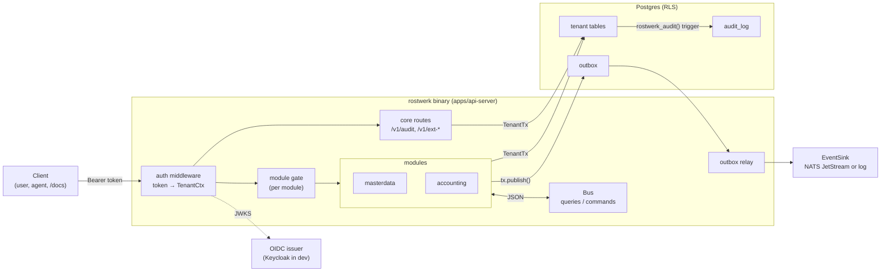
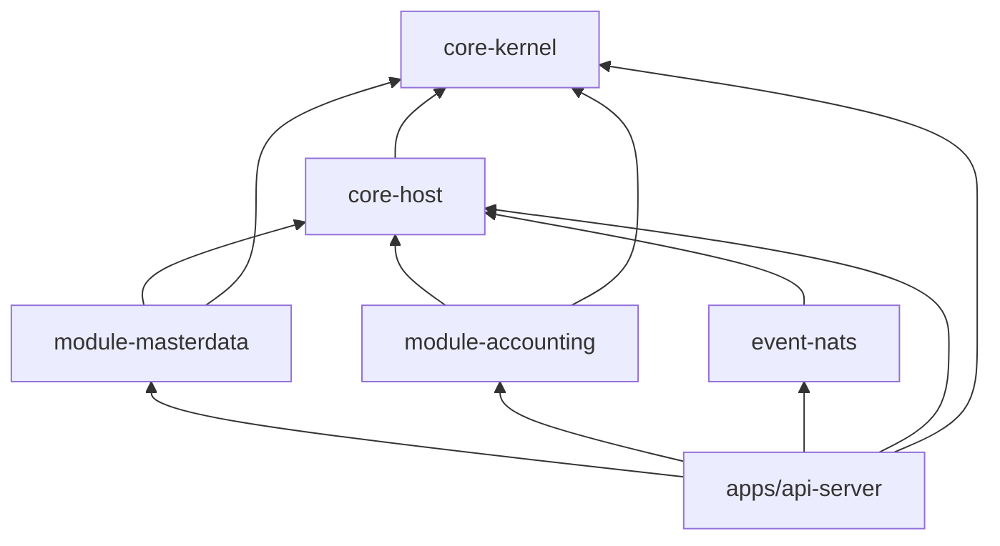

# Architecture

How Rostwerk is put together today, and where it is heading. Everything outside the
[Planned](#planned) section describes the code on `main`; if you find a statement that
no longer matches the code, fix the document in the same PR.

Code rules live in [CONTRIBUTING.md](../CONTRIBUTING.md), the pickup protocol in
[AGENTS.md](../AGENTS.md), setup and API examples in the [README](../README.md).

## Overview

Rostwerk is one Rust binary (`rostwerk`, in `apps/api-server`) that serves an HTTP API
over one Postgres database. A **core** handles authentication, tenants, data access,
audit and events. **Modules** (master data, accounting, ...) are compiled into the
binary; each tenant switches them on or off. Several tenants (companies) share one
instance and one database; Postgres row-level security keeps their data apart.

## Crate layout and dependency direction

| Crate | Role |
| --- | --- |
| `crates/core-kernel` | `TenantCtx`, `Actor`, `Db`, `TenantTx` (tenant-scoped transaction), `SystemTx`, IDs, `Money`, the shared `Error`. No knowledge of modules. |
| `crates/core-host` | `Module` trait, `ModuleRegistry` (migrations, routes, per-tenant gate), `Bus`, `DryRun`, custom fields (`ext`), tenant registry, memberships, audit read API, outbox relay and `EventSink`. Core migrations. |
| `crates/module-masterdata` | Business partners and articles. Offers `masterdata.partner.get` on the bus. |
| `crates/module-accounting` | Chart of accounts and double-entry journal with immutable posted entries. |
| `crates/event-nats` | `EventSink` that publishes to NATS JetStream. Separate so the core does not depend on a NATS client. |
| `apps/api-server` | Wires everything into one router: auth (OIDC, dev tokens), `/admin`, `/docs`, `/openapi.json`, `/health`. Builds the `rostwerk` binary. |

Dependencies point one way:

- Modules depend only on `core-host` and `core-kernel`, never on each other. They talk
  through the core (see [Module boundaries](#module-boundaries)).
- Only `apps/api-server` knows which modules exist: `registry()` in
  `apps/api-server/src/lib.rs` registers them.

## Startup

`apps/api-server/src/main.rs`:

1. Connects with `DATABASE_ADMIN_URL` (owner role `rostwerk_admin`) and runs
   `ModuleRegistry::migrate`: core migrations first, then each module's. All share one
   sqlx history table, so migration versions must be unique across modules.
2. Connects with `DATABASE_URL` as `rostwerk_app`, a role with `NOSUPERUSER NOBYPASSRLS`
   (`docker/postgres/init`), so row-level security always applies to the server.
3. Builds `AuthConfig` from the environment and starts the outbox relay as a background
   task (NATS sink if `NATS_URL` is set, otherwise `LogSink`).
4. Serves `app(...)` from `apps/api-server/src/lib.rs`.

## Request lifecycle

The router in `apps/api-server/src/lib.rs` has three kinds of routes:

| Routes | Protection |
| --- | --- |
| `/health`, `/docs`, `/openapi.json` | none |
| `/admin/...` (tenants, modules, members) | static `ROSTWERK_ADMIN_TOKEN`; `404` if unset |
| `/v1/...` core and module routes | `auth::authenticate`, then the module gate for module routes |

A tenant request runs through these steps:

1. **Authentication** (`apps/api-server/src/auth/mod.rs`). The bearer token is either a
   dev token `dev:<tenant>:<user>` (only with `ROSTWERK_DEV_AUTH=1`) or an OIDC access
   token, verified against the issuer's JWKS (`auth/oidc.rs`). Invalid or missing: `401`.
2. **Tenant resolution.** The token says *who*; `tenant_members` says *where* and *as
   what*. `members::memberships_of` looks up the `sub` (optionally narrowed by
   `X-Rostwerk-Tenant`): no membership `403`, several without header `400`. The result
   is a `TenantCtx` with tenant id, actor (`user:` or `agent:`, from the
   membership kind) and the tenant's enabled modules. It is put into the request
   extensions; it is never built from client input.
3. **Module gate** (`core-host/src/registry.rs`, `module_gate`). Every module's routes
   get a route layer that answers `404` if the tenant has not enabled that module. Core
   routes (`/v1/audit`, `/v1/ext-entities`, `/v1/ext-fields`) are not gated.
4. **Handler.** Takes `TenantCtx` as an extractor (missing context is `401`) and opens
   a transaction with `ctx.begin(&state.db)`.
5. **`TenantTx` with RLS** (`core-kernel/src/db.rs`). `begin` sets `app.tenant_id` and
   `app.actor` with `set_config(..., true)`, i.e. local to the transaction. Every tenant
   table has `ENABLE` and `FORCE ROW LEVEL SECURITY` and a policy
   `tenant_id = current_setting('app.tenant_id')`. A query outside a tenant transaction
   sees no rows and cannot write any.
6. **Writes** go through the same transaction: rows, audit entries (trigger) and outbox
   events (`tx.publish`) commit or roll back together. Write handlers end with
   `dry_run.respond(tx, status, body)`, which commits, or rolls back for
   `Prefer: dry-run` and returns the would-be result with the recorded events
   (`core-host/src/dry_run.rs`). A test (`every_write_endpoint_documents_dry_run`)
   fails if a `/v1` write endpoint does not declare `params(DryRun)`.
7. **Errors** are `core_kernel::Error`, which maps to the HTTP status and a JSON error
   body (`core-kernel/src/error.rs`).

Core services that run before a tenant is known (tenant registry, memberships) use
`Db::system_pool()` on tables without RLS (`tenants`, `tenant_members`). Module code
must not use it. Background jobs use `Db::begin_system()`, which sets `app.system = on`;
only tables whose policy allows that (today: `outbox`) become visible across tenants.

## Audit log

`crates/core-host/migrations/20261117000002_audit_outbox.sql`.

- A module opts a table in with one line, so no handler can forget it:
  `CREATE TRIGGER <table>_audit AFTER INSERT OR UPDATE OR DELETE ON <table> FOR EACH ROW EXECUTE FUNCTION rostwerk_audit();`
  The table needs `id uuid` and `tenant_id uuid`.
- `rostwerk_audit()` writes actor (from `app.actor`, or `db:<role>` for changes outside
  the API), entity type (table name), entity id, action, `before` and `after` as JSON,
  and the transaction id.
- `audit_log` is append-only: triggers reject updates, deletes and truncation, and a
  guard rejects inserts that do not come from the `SECURITY DEFINER` trigger function.
  It is tenant-scoped by RLS like every tenant table.
- Read it via `GET /v1/audit` (`core-host/src/audit.rs`).

Because the audit entry is written in the same transaction, a rolled-back or dry-run
transaction leaves no audit entry behind.

## Outbox and events

- A module records a domain event with `tx.publish(topic, &payload)` inside its tenant
  transaction. The row in `outbox` exists only if the transaction commits. Topics are
  `<module>.<entity>.<event>`, e.g. `masterdata.partner.created`; the core uses
  `core.*` (e.g. `core.ext_field.defined`).
- The relay (`core-host/src/outbox.rs`, `run_relay`) polls every 500 ms in a
  `SystemTx`, takes up to 100 unpublished rows with `FOR UPDATE SKIP LOCKED` (several
  relays may run in parallel), hands them to the `EventSink` and marks them published
  only after the sink accepted them. Delivery is at-least-once; consumers dedupe on the
  event id.
- `event-nats` publishes each event on `rostwerk.<tenant_id>.<topic>` in the stream
  `ROSTWERK` and sends the event id as `Nats-Msg-Id`, so JetStream drops redeliveries
  within its duplicate window. Without `NATS_URL`, `LogSink` writes events to the log.

## Module boundaries

A module implements `core_host::Module` (`core-host/src/lib.rs`):

| Method | Purpose |
| --- | --- |
| `manifest()` | Stable id (used in `tenants.modules`), name, version, description |
| `migrator()` | The module's own migrations |
| `routes()` | HTTP routes with utoipa OpenAPI annotations; merged into `/openapi.json` |
| `operations()` | Queries and commands offered to other modules on the bus |
| `extensible_entities()` | Entities tenants may add custom fields to, named `<module>.<entity>` |

Rules (also in CONTRIBUTING.md):

- **No reading another module's tables.** Modules talk through the core: bus queries and
  commands, and events.
- **Bus** (`core-host/src/bus.rs`). Operations are named `<module>.<entity>.<verb>` and
  must start with the registering module's id. Requests and responses cross the bus as
  JSON, so the caller does not depend on the callee's crate. Every call runs in the
  caller's `TenantCtx`. `Bus::query` / `Bus::command` open and commit their own
  transaction; a write handler that already holds a `TenantTx` uses `Bus::command_in`,
  which runs the command in the caller's transaction inside a savepoint, so dry runs
  and failures roll it back with the caller. `ModuleRegistry::operations()` lists all
  operations with their JSON Schemas, as input for agent tool specs.
- **Custom fields** (`core-host/src/ext.rs`). Tenants define fields per entity and key
  (never by generated id, so a field is the same on every system). Values live in the
  entity's `ext` jsonb column; the module validates them with `ExtSchema` on every write
  and filters them on read. `GET /v1/ext-fields/{entity}/schema` returns the effective
  JSON Schema. Definitions may be changed only on a Dev system
  (`ROSTWERK_SYSTEM_ROLE=dev`); QAS and PROD answer `409`.
- **Invariants in the database.** Where a rule must hold no matter which code path
  writes, it is enforced in Postgres too, e.g. accounting's triggers that make posted
  journal entries and their lines immutable and check balance and the gapless sequence
  number on posting.
- **Queries** use the compile-time checked `sqlx::query!` macros with the offline
  metadata in `.sqlx/` (see CONTRIBUTING.md).

## Planned

> **Not implemented yet.** This section describes the direction, not the code. Details
> are decided in the linked issues.

| Topic | Direction | Issue |
| --- | --- | --- |
| Policies for users and agents | Cedar (`cedar-policy`, in-process) evaluated on every request, roles per membership, module default policies plus tenant overrides, field-level read masking and write rejection. Agents are already first-class identities (`agent:`); Cedar narrows what they may do. | [#12](https://github.com/nerdishbynature/Rostwerk/issues/12) |
| Human-in-the-loop proposals | Commands stored as proposals with their dry-run result and executed only after a human approves. | [#13](https://github.com/nerdishbynature/Rostwerk/issues/13) |
| Workflow engine | A workflow/saga engine coordinating multi-step processes on top of proposals and dry runs. Choice deferred. | no issue yet (see [#13](https://github.com/nerdishbynature/Rostwerk/issues/13)) |
| Semantic layer for agents | Per-tenant tool specs generated from the OpenAPI spec and bus operations, filtered to enabled modules; then an MCP server on top. | [#11](https://github.com/nerdishbynature/Rostwerk/issues/11), [#25](https://github.com/nerdishbynature/Rostwerk/issues/25) |
| Transports | Customizing (custom fields, later policies) moved Dev → QAS → PROD by transports; QAS and PROD already reject direct changes. | no issue yet |
| WASM extensions | Tenant logic as WebAssembly components (wasmtime component model). | no issue yet |
| Analytics | CDC from Postgres to Parquet/Iceberg, queried with DataFusion and served over Arrow Flight. Optional, never required for a basic install. | [#14](https://github.com/nerdishbynature/Rostwerk/issues/14) |
| UI | Rust, native desktop and WASM web from one codebase; every write through the API. Web sign-in via a backend-for-frontend session. | [#20](https://github.com/nerdishbynature/Rostwerk/issues/20), [#35](https://github.com/nerdishbynature/Rostwerk/issues/35) |
| Self-hosting | Single image that migrates and serves, production compose with Zitadel. | [#26](https://github.com/nerdishbynature/Rostwerk/issues/26) |

Already done from the original plan, described above: NATS JetStream sink (#2),
module bus (#4), dry runs (#5), custom fields with the schema endpoint (#6) and
compile-time checked queries (#3).
